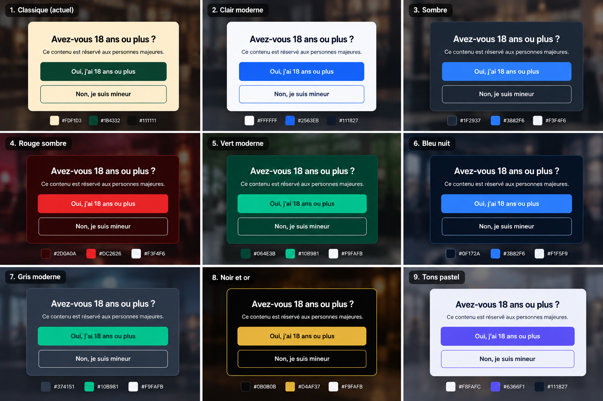

# Maquettes des palettes de couleurs

Cette image présente neuf **propositions graphiques conceptuelles** pour le
widget Age Verification. Elle sert de référence de conception : ce ne sont ni
des captures de tests fonctionnels ni des versions déjà implémentées du
widget. Aucune de ces palettes ne constitue une vérification d'âge fiable ou
un contrôle d'accès à du contenu sensible.

Les couleurs du widget peuvent être configurées sans modifier le JavaScript,
au moyen des variables d'environnement documentées par le projet, notamment
`MODAL_BG_COLOR`, `TEXT_COLOR`, `BTN_YES_BG`, `BTN_YES_COLOR`, `BTN_NO_BG` et
`BTN_NO_COLOR`.

| # | Palette | Fond de fenêtre | Action positive | Texte |
| --- | --- | --- | --- | --- |
| 1 | Classique (actuel) | `#FDF1D3` | `#1B4332` | `#111111` |
| 2 | Clair moderne | `#FFFFFF` | `#2563EB` | `#111827` |
| 3 | Sombre | `#1F2937` | `#3B82F6` | `#F3F4F6` |
| 4 | Rouge sombre | `#2D0A0A` | `#DC2626` | `#F3F4F6` |
| 5 | Vert moderne | `#064E3B` | `#10B981` | `#F9FAFB` |
| 6 | Bleu nuit | `#0F172A` | `#3B82F6` | `#F1F5F9` |
| 7 | Gris moderne | `#374151` | `#10B981` | `#F9FAFB` |
| 8 | Noir et or | `#0B0B0B` | `#D4AF37` | `#F9FAFB` |
| 9 | Tons pastel | `#F8FAFC` | `#6366F1` | `#111827` |

Les teintes des boutons secondaires, bordures et arrière-plans de page dans
la maquette sont des choix de présentation destinés à rendre chaque variante
lisible. Elles n'ajoutent aucune option de configuration et n'impliquent aucun
changement au code du widget.
